# Matfess

Matfess adalah aplikasi Android untuk mahasiswa: catatan kuliah, tugas dengan alarm, jadwal kelas, pelacak semester, hitung mundur UTS/UAS, target kelulusan, daftar mata kuliah ulang, kalender event kampus, pembagi kelompok acak, brankas modul/sertifikat, mode Jangan Ganggu, kalkulator IPK, dan Pomodoro timer.

Tampilan memakai bahasa desain **Liquid Glass** (permukaan translusen, rim terang, bloom lembut, animasi pegas) dengan dukungan penuh **mode terang dan gelap**. Seluruh data akademik disimpan lokal memakai **SQLite**, sedangkan dua endpoint **REST API** (Retrofit) dipakai untuk hari libur nasional dan kutipan motivasi.

## Tampilan aplikasi

Screenshot diambil langsung dari build debug pada emulator Android 7.1 (API 25), resolusi 1440 × 2560.

<table>
  <tr>
    <td align="center">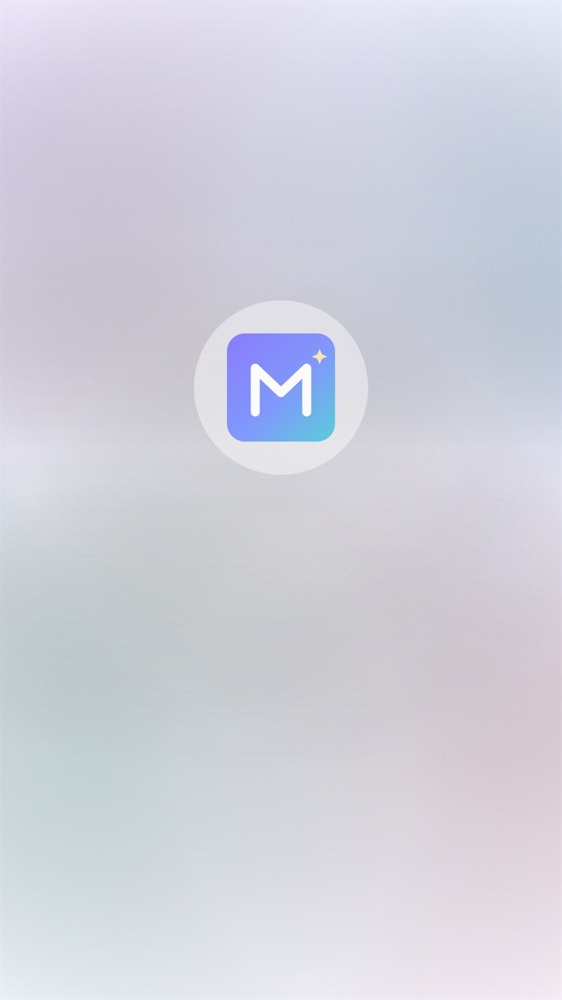<br><sub><b>Splash</b></sub></td>
    <td align="center">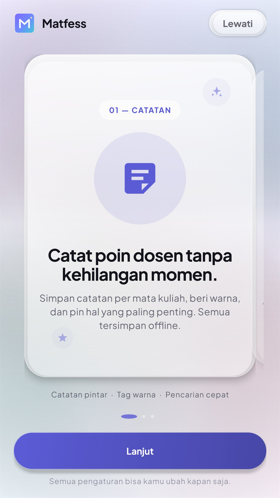<br><sub><b>Onboarding · Catatan</b></sub></td>
    <td align="center">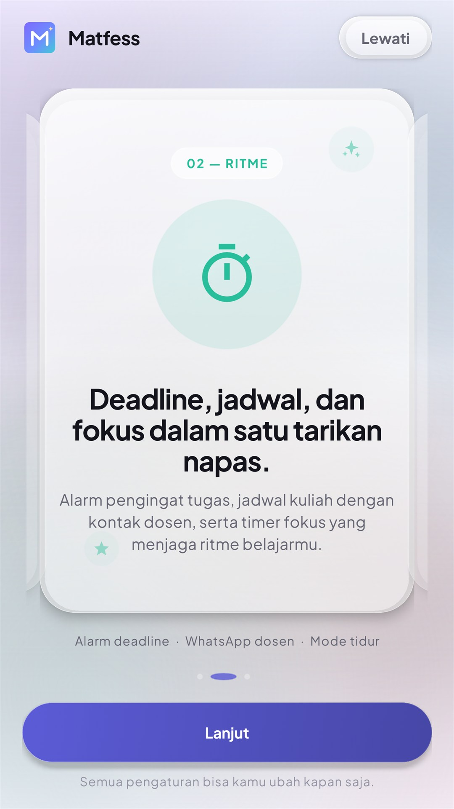<br><sub><b>Onboarding · Ritme</b></sub></td>
  </tr>
  <tr>
    <td align="center">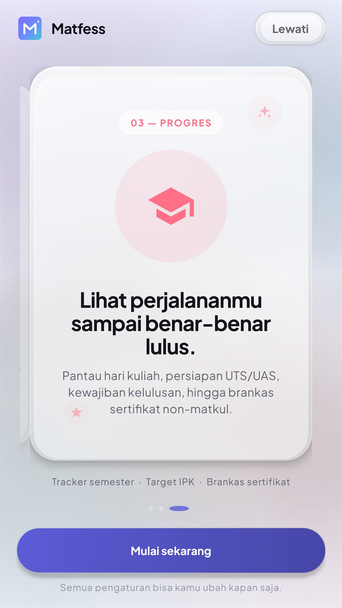<br><sub><b>Onboarding · Progres</b></sub></td>
    <td align="center">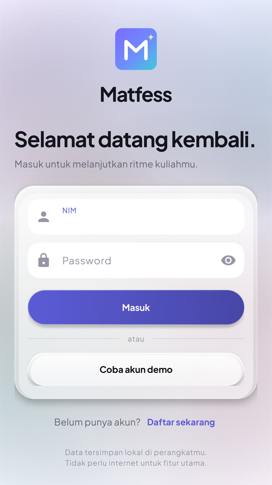<br><sub><b>Masuk / Login</b></sub></td>
    <td align="center">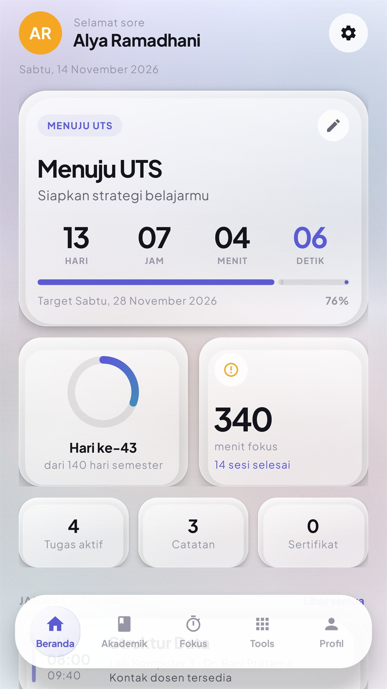<br><sub><b>Beranda</b></sub></td>
  </tr>
  <tr>
    <td align="center">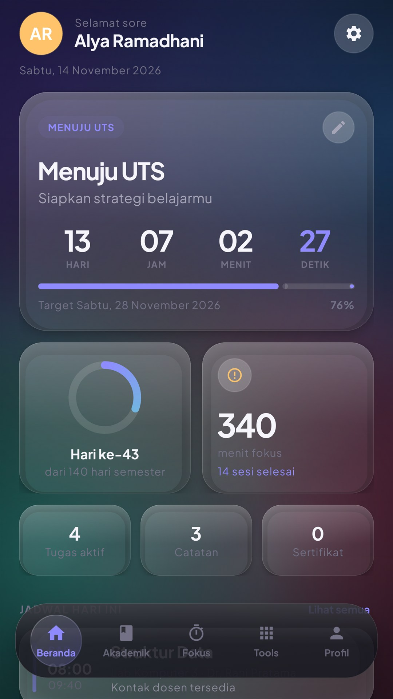<br><sub><b>Beranda · Mode gelap</b></sub></td>
    <td align="center">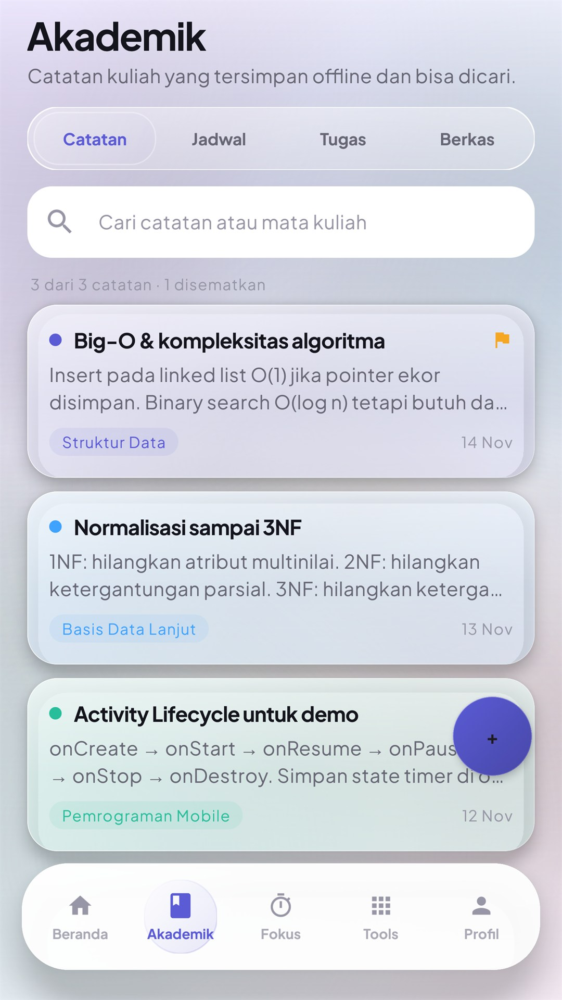<br><sub><b>Akademik · Catatan</b></sub></td>
    <td align="center">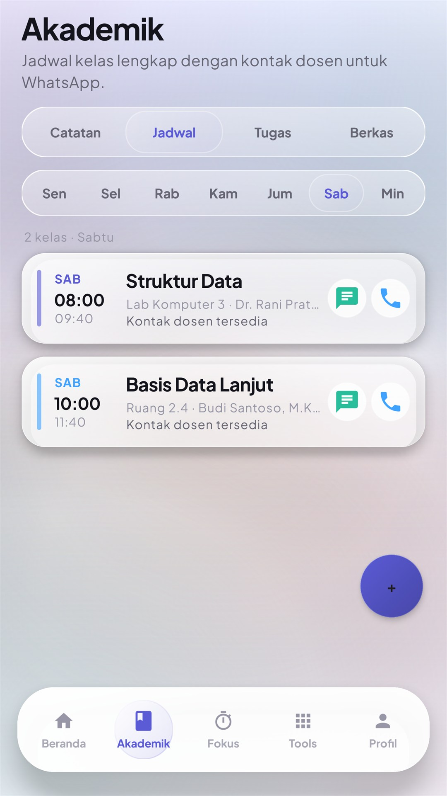<br><sub><b>Akademik · Jadwal</b></sub></td>
  </tr>
  <tr>
    <td align="center">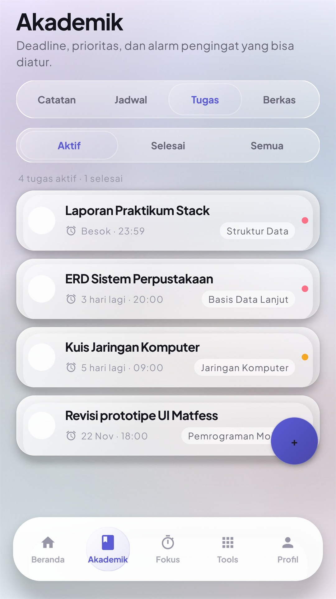<br><sub><b>Akademik · Tugas</b></sub></td>
    <td align="center">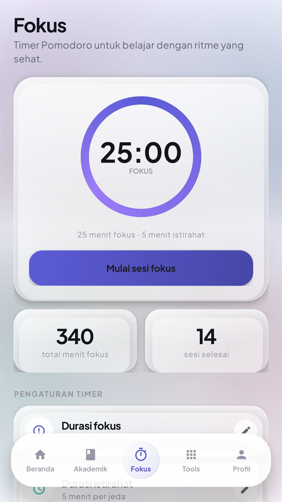<br><sub><b>Fokus · Pomodoro</b></sub></td>
    <td align="center">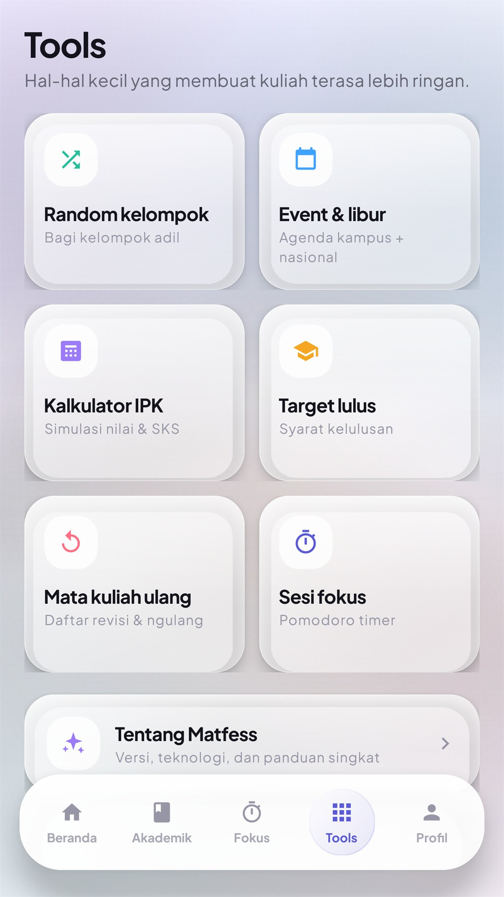<br><sub><b>Tools</b></sub></td>
  </tr>
  <tr>
    <td align="center">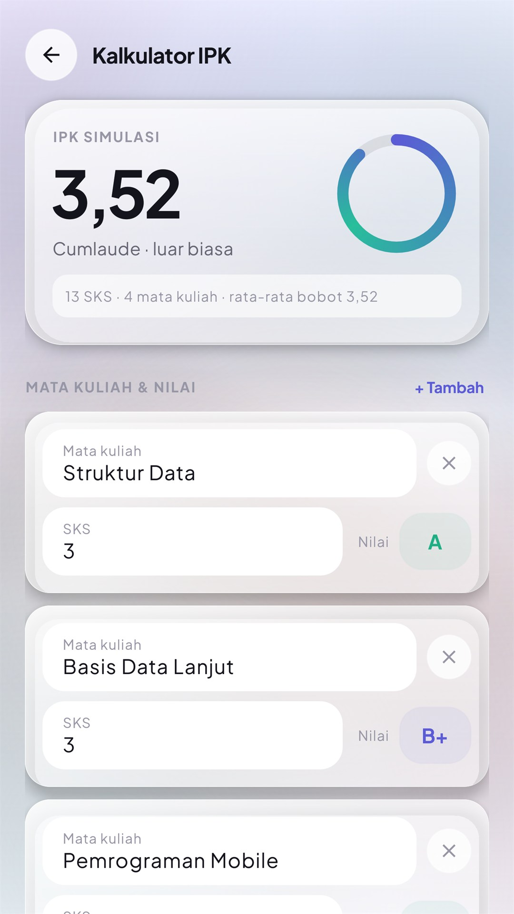<br><sub><b>Kalkulator IPK</b></sub></td>
    <td align="center">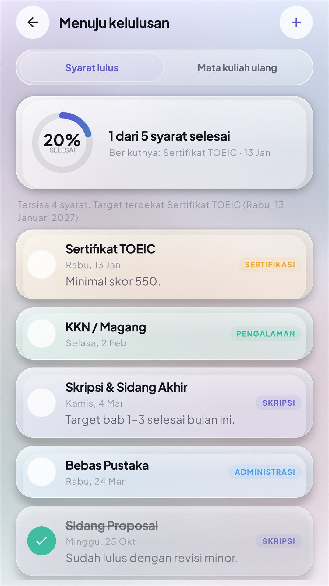<br><sub><b>Menuju kelulusan</b></sub></td>
    <td align="center">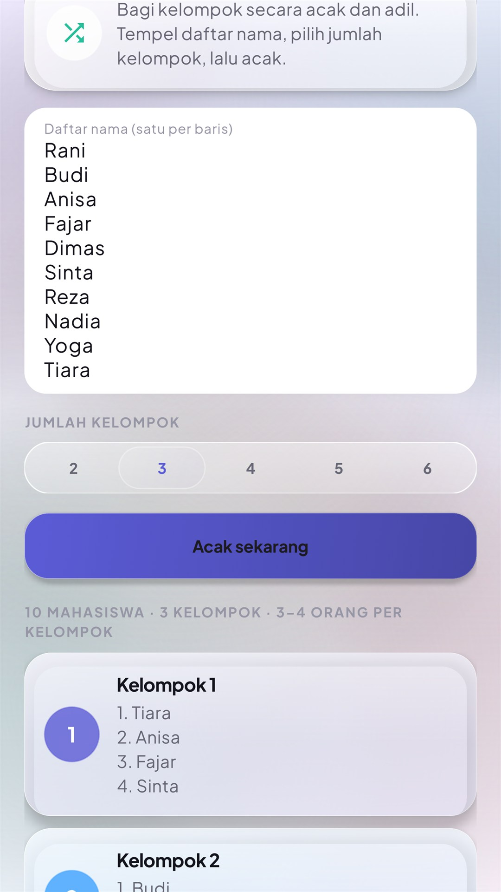<br><sub><b>Random kelompok</b></sub></td>
  </tr>
  <tr>
    <td align="center">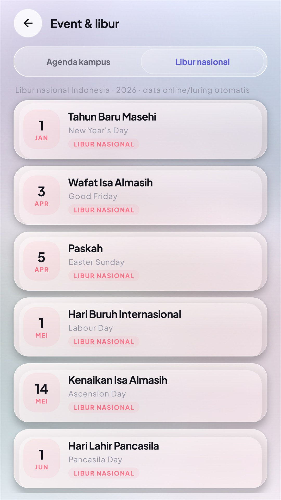<br><sub><b>Libur nasional · REST API</b></sub></td>
    <td align="center">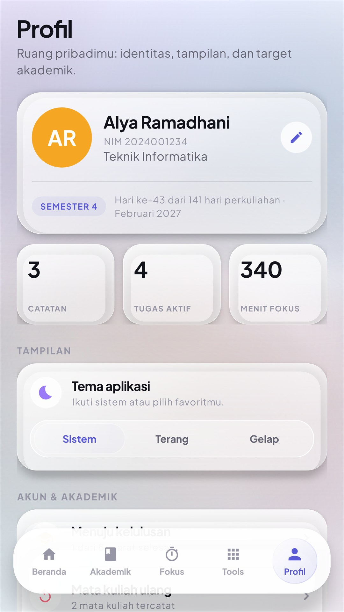<br><sub><b>Profil</b></sub></td>
    <td align="center">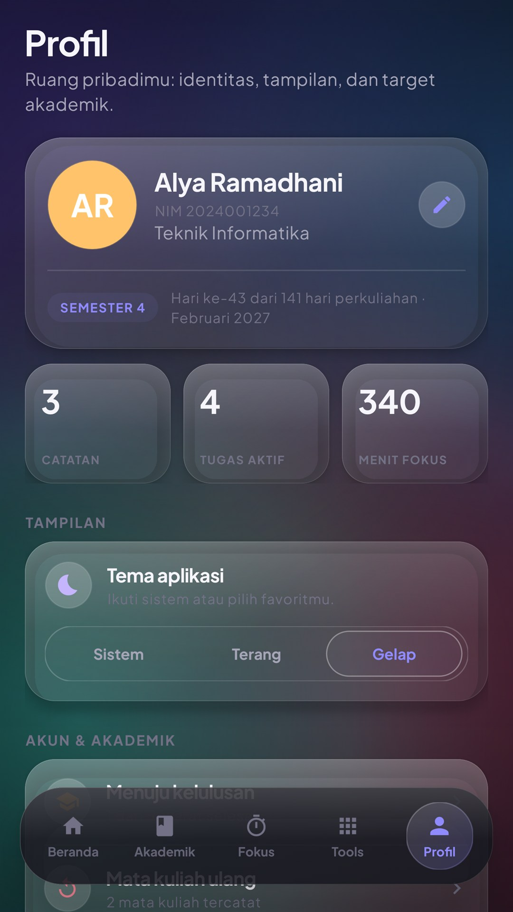<br><sub><b>Profil · Mode gelap</b></sub></td>
  </tr>
</table>

## Unduh APK

APK debug siap dipasang tersedia di repo: **[`dist/Matfess-debug.apk`](dist/Matfess-debug.apk)** (±10,4 MB).

Di halaman GitHub, buka file tersebut lalu klik **Download raw file**. Aktifkan "Install unknown apps" untuk sumber file, kemudian pasang seperti biasa.

## Demo cepat

| Item | Nilai |
| --- | --- |
| NIM | `2024001234` |
| Password | `matfess` |

Di halaman login tersedia tombol **Coba akun demo** yang otomatis membuat akun tersebut beserta data contoh (mata kuliah, catatan, tugas, event, target kelulusan, dan mata kuliah ulang). Akun baru juga bisa dibuat lewat halaman daftar.

## Menjalankan proyek

Prasyarat: Android Studio terbaru, JDK 17/21, Android SDK 36, dan koneksi internet untuk unduhan dependensi pertama kali.

1. Buka folder `MatfessLiquid` di Android Studio.
2. Tunggu Gradle sync selesai.
3. Jalankan konfigurasi `app` pada emulator/HP dengan Android 7.1 (API 25) atau lebih baru.

Lewat terminal:

```powershell
cd MatfessLiquid
.\gradlew.bat :app:assembleDebug
.\gradlew.bat :app:installDebug
```

APK debug dihasilkan di `app/build/outputs/apk/debug/app-debug.apk`.

Izin yang diminta: notifikasi (Android 13+), alarm tepat waktu, dan akses Jangan Ganggu saat mode tidur/fokus diaktifkan.

## Fitur

### Akademik
- **Catatan kuliah** — CRUD, warna penanda, sematkan di atas, pencarian, pemilih mata kuliah.
- **Jadwal kelas** — CRUD, ruang, dosen, nomor telepon/WhatsApp dosen, warna kartu, alarm pengingat sebelum kelas dan reminder akhir kelas.
- **Tugas** — CRUD, prioritas, tenggat kustom (tanggal + jam), alarm pengingat yang bisa diatur, tandai selesai, filter.
- **Berkas** — modul dan sertifikat lewat Storage Access Framework, buka file, hapus.
- **Menuju kelulusan** — checklist syarat (Skripsi, Administrasi, Sertifikasi, Pengalaman, Lainnya) dengan target tanggal dan progres.
- **Mata kuliah ulang** — catat nilai C/D/E, target semester, dan catatan perbaikan.

### Beranda & waktu
- Salam harian, avatar inisial, dan statistik cepat.
- Hitung mundur UTS/UAS yang berdetak tiap detik; semua tanggal bisa diubah.
- Penghitung hari semester dengan cincin progres; tanggal awal/akhir semester dapat diatur.
- Daftar kelas hari ini dan tugas terdekat.
- Kutipan motivasi dari DummyJSON dengan cache offline.
- Tombol pintas Jangan Ganggu / mode tidur.

### Tools
- **Random kelompok** — bagi nama menjadi beberapa kelompok secara adil, animasi stagger, hasil bisa diacak ulang.
- **Event kampus** — CRUD agenda kampus, plus hari libur nasional Indonesia dari Nager.Date (fallback offline).
- **Kalkulator IPK** — baris mata kuliah + SKS + nilai, predikat, ring progres, draf tersimpan otomatis.
- **Sesi fokus** — Pomodoro dengan durasi fokus/istirahat yang bisa diatur, selalu akurat saat aplikasi di latar belakang, notifikasi, dan integrasi DND.

### Profil
- Identitas mahasiswa (nama, NIM, program studi, semester) yang bisa diubah.
- Statistik catatan, tugas aktif, dan total menit fokus.
- Pemilih tema **Sistem / Terang / Gelap** yang langsung diterapkan.
- Pintasan ke kelulusan, mata kuliah ulang, kalkulator IPK, dan dialog tentang aplikasi.
- Keluar akun dengan konfirmasi; data tetap tersimpan.

## Arsitektur

```
app/src/main/java/com/matfess/app/
├── data/            Models, DbHelper (SQLite), Prefs, MatfessRepository
├── network/         ApiService, ApiClient (Retrofit), RemoteRepository, DTO
├── service/         NotificationHelper, AlarmScheduler, AlarmReceiver, BootReceiver, DndHelper
├── ui/
│   ├── auth/        Login, Register
│   ├── onboarding/  Onboarding ViewPager2
│   ├── splash/      Splash + sesi
│   ├── main/        MainActivity, NavHost, tab bar kaca
│   ├── home/        Dashboard
│   ├── academic/    Hub 4 halaman: Catatan, Jadwal, Tugas, Berkas
│   ├── focus/       Timer Pomodoro (Activity + Fragment)
│   ├── tools/       Random kelompok, Event, IPK
│   ├── profile/     Profil, Kelulusan, Mata kuliah ulang
│   ├── common/      BaseActivity/Fragment, AuroraView, GlassCardView,
│   │                LiquidButton, LiquidSegmented, GlassSwitch,
│   │                ProgressRingView, LiquidLensView
│   └── schedule/ tasks/ notes/ documents/  Adapter & editor
└── util/            DateUtils, PickerUtils, Palette, ViewExt
```

- **Pola:** Activity + Fragment + Navigation Component, ViewBinding, `RecyclerView`/`ListAdapter` + `DiffUtil`.
- **Database:** `SQLiteOpenHelper` dengan tabel `users`, `courses`, `notes`, `tasks`, `documents`, `graduation_items`, `revisions`, dan `events`; operasi CRUD lengkap dan tanpa ORM.
- **Penyimpanan ringan:** `SharedPreferences` untuk sesi, tema, timeline semester, statistik fokus, cache kutipan, dan draf IPK.
- **Jaringan:** Retrofit 2 + Gson + OkHttp logging; setiap layar tetap berfungsi saat offline.
- **Animasi:** `SpringAnimation` untuk lensa tab, `ValueAnimator` untuk cincin dan segmented control, `OvershootInterpolator` untuk tombol, serta entrance fade/slide pada kartu.

## REST API

| API | Endpoint | Pemakaian |
| --- | --- | --- |
| Nager.Date | `https://date.nager.at/api/v3/PublicHolidays/{tahun}/ID` | Hari libur nasional Indonesia di layar Event |
| DummyJSON | `https://dummyjson.com/quotes/random` | Kutipan motivasi di Beranda |

Keduanya menyediakan fallback lokal sehingga UI tidak kosong ketika perangkat offline.

## Pemetaan rubrik

| Komponen | Implementasi |
| --- | --- |
| **Activity Lifecycle** | `BaseActivity` + `BaseFragment` mencatat `onCreate`, `onStart`, `onResume`, `onPause`, `onStop`, `onDestroy`; `HomeFragment` memperbarui hitung mundur di `onResume`; `StudyTimerActivity` menyimpan state di `onPause`/`onSaveInstanceState` dan melanjutkan berdasarkan `SystemClock.elapsedRealtime`. |
| **Fragment & Navigation** | `NavHostFragment`, `nav_main.xml`, bottom navigation kaca dengan lensa geser; onboarding memakai `ViewPager2` + 3 fragment; hub akademik memakai `ViewPager2` + 4 fragment. |
| **RecyclerView & Event Handling** | Daftar catatan, jadwal, tugas, berkas, event, libur, kelompok, kelulusan, dan mata kuliah ulang memakai `RecyclerView`; mendukung klik, long-click (hapus/pin), tombol aksi (WhatsApp dosen, buka file, centang). |
| **SQLite (CRUD)** | `DbHelper` dengan 8 tabel dan operasi insert/read/update/delete untuk semua entitas; dipakai seluruh layar. |
| **CardView & animasi scale** | Semua kartu memakai `GlassCardView` (turunan `FrameLayout` dengan fill/rim/bloom, elevasi, dan pegas saat ditekan); `LiquidButton` juga memberi scale-down 0.96x dan scale-up. |
| **REST API + Retrofit** | `ApiClient`, `ApiService`, `RemoteRepository`; Nager.Date dan DummyJSON dengan loading/fallback offline. |
| **UI/UX** | Liquid Glass, palet lavender/sky/mint/coral, font Plus Jakarta Sans, dukungan light/dark, animasi masuk, segmented control, dan ring progres. |

## Catatan implementasi

- Mode gelap mengikuti `AppCompatDelegate`; pilihan disimpan di `Prefs.themeMode` dan diterapkan ulang saat aplikasi dibuka.
- Alarm memakai `AlarmManager`; setelah reboot, `BootReceiver` menjadwalkan ulang alarm kelas dan tugas.
- Semua tanggal dan durasi dapat diubah dari UI (tanggal ujian, awal/akhir semester, tenggat tugas, target kelulusan, durasi Pomodoro).
- Data demo dibuat sekali; menghapus data aplikasi akan mengembalikan kondisi awal.
